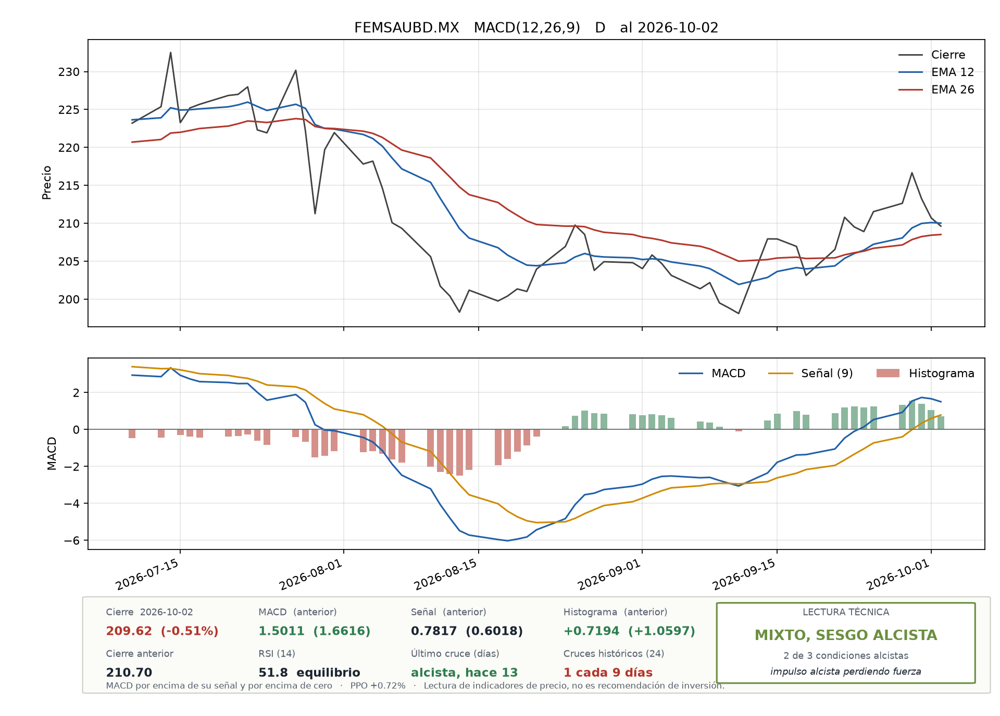

# EMA/MACD signal toolkit

[](https://github.com/lobby9000/macd-toolkit/actions/workflows/tests.yml)

Moving averages, MACD(12, 26, 9) and RSI(14) implemented from first principles in Python, cross-validated against an independent Excel model and run in batch over 35 equities listed on the Mexican Stock Exchange (BMV).



## Highlights

- **Two independent implementations that agree.** The Excel workbook in [`excel/`](excel/plantilla_MACD.xlsx) computes the same indicators with 3,815 linked formulas. A [cross-check script](scripts/excel_crosscheck.py) recalculates it in LibreOffice and matches every quantity to within 5.1 × 10⁻¹³, with the same 9 crossovers flagged on both sides.
- **Tests that check the mathematics.** 31 unit tests cover properties that can be derived by hand: equality with pandas `ewm(adjust=False)`, a lag of (N − 1)/2 on a linear trend, MACD equal to 7 × slope on a constant trend, the first signal value at t = 34 and the RSI example from class (RS = 3.6 gives 78.26).
- **Batch runs over a whole market.** `batch_macd.py` analyses the 35 tickers in [`bmv_tickers.txt`](bmv_tickers.txt) in one pass and writes a chart and CSV files per ticker plus a summary table sorted by the most recent crossover. It also detects tickers whose Yahoo Finance feed is missing the latest sessions and retries them.

## Quick start

Requires Python 3.10 or newer.

```bash
python3 -m venv .venv && source .venv/bin/activate
pip install -r requirements.txt
python -m pytest

# One ticker: weekly closes, two years of history, cut-off on a fixed Friday
python macd_toolkit.py FEMSAUBD.MX --freq W --years 2 --show 26 --asof 2026-09-18 --out figures

# The whole list: daily closes, one year of history
python batch_macd.py bmv_tickers.txt --freq D --years 1 --asof 2026-10-02 --out results
```

Tickers use the Yahoo Finance format, so BMV symbols carry the `.MX` suffix. `--csv` (single ticker) and `--csv-dir` (batch) read your own closing prices instead of downloading them.

## Method

With $P_t$ the close of period $t$:

| Quantity | Definition | First value |
|---|---|---|
| SMA | $\frac{1}{N}\sum_{i=0}^{N-1} P_{t-i}$ | $t = N$ |
| EMA | $\alpha P_t + (1-\alpha)\,\mathrm{EMA}_{t-1}$ with $\alpha = 2/(N+1)$, seeded with the SMA of the first $N$ closes | $t = N$ |
| MACD | $\mathrm{EMA}_{12} - \mathrm{EMA}_{26}$ | $t = 26$ |
| Signal | 9-period EMA of the MACD series | $t = 34$ |
| Histogram | MACD − signal | $t = 34$ |
| PPO | $100 \times (\mathrm{EMA}_{12} - \mathrm{EMA}_{26}) / \mathrm{EMA}_{26}$, to compare tickers with different price levels | $t = 26$ |
| RSI(14) | $100 - 100/(1 + RS)$, with simple averages (the class method) or Wilder's smoothing | $t = 15$ |

The SMA seed follows the textbook convention used by StockCharts. `--seed first` seeds with the first close instead, which is what pandas `ewm(span=N, adjust=False)` does. The seed's influence decays as $(1-\alpha)^k$, roughly 60 periods for the 26-period EMA to fall below 1%, so the scripts download more history than they report.

Weekly and monthly closes are resampled from daily data. The period still in progress is dropped unless `--incluir-parcial` is passed, because a Monday run would otherwise treat Monday's close as the weekly close. `--asof` fixes the last period, so a run gives the same answer whenever it is repeated.

## Validation

`python scripts/excel_crosscheck.py` on the synthetic series that ships with the workbook (104 weekly closes):

| Quantity | Values compared | Largest difference |
|---|---:|---:|
| EMA 12 / EMA 26 | 93 / 79 | 5.1 × 10⁻¹³ |
| MACD, signal, histogram | 79 / 71 / 71 | 5.0 × 10⁻¹⁴ |
| PPO | 79 | 6.2 × 10⁻¹⁵ |
| MACD and signal, SMA variant | 79 / 71 | 7.3 × 10⁻¹⁴ |
| RSI 14, class method and Wilder | 90 / 90 | 6.4 × 10⁻¹⁴ |
| Worked example, MACD(3, 6, 3) on 12 prices | 7 | 4.4 × 10⁻¹⁵ |

The differences are at the level of the 15 significant digits Excel stores. CI runs the cross-check on every push alongside the unit tests.

### A defect found later

The tests of the [MACD signal API](https://github.com/lobby9000/macd-signal-api), which wraps this toolkit, found that on perfectly flat or linear stretches the histogram is rounding noise of about 10⁻¹⁵ that changes sign, and `crossovers()` reported it as a crossover. Real prices can do this when a thinly traded stock repeats its close. `crossovers()` now treats values within 10⁻⁹ of the largest close as zero, and two regression tests keep both the fix and genuine crossovers after a flat stretch covered.

### How often is too often

A crossover only means something if crossovers are rarer than chance would make them. On a random walk, where there is no trend to find, MACD(12, 26, 9) still crosses its signal about once every 12 periods: 12.3 on average over 40 simulated walks of 3,000 steps, between 10.8 and 14.0 ([`scripts/random_walk_crossings.py`](scripts/random_walk_crossings.py)). On one-minute candles that would be about 117 crossings a day.

The summary panel therefore flags a ticker whose history averages fewer than 12 periods between crossings (`PERIODOS_RUIDO` in `macd_toolkit.py`). The threshold used to be 10, tied to the 9-period signal line, but none of the 40 random walks crossed that often, so it let pure noise through unflagged. Applied to the daily run of 2 October 2026, the median BMV ticker crosses once every 11.8 days, and 22 of the 35 tickers fall under the new threshold, against 7 under the old one. A test keeps the threshold within one period of the simulated average.

## Example output

[`examples/bmv-daily-2026-10-02/`](examples/bmv-daily-2026-10-02/) holds the summary of a daily run over the 35 tickers with a cut-off of 2 October 2026 (`resumen.md` and `resumen.csv`) and two of the charts. Every chart carries a summary panel with the latest close, MACD, signal, histogram, RSI and the last crossover, plus a technical reading that counts three conditions: MACD above its signal, MACD above zero and a rising histogram. The panel also shows how often the ticker has crossed historically and flags it when that is as often as on a random walk (see [How often is too often](#how-often-is-too-often)). The two charts come from the version of 2 October, which flagged at 10 periods and rounded the interval to whole periods. Under the current threshold WALMEX, at one crossing every 11.8 days, would be flagged as well.

## Repository structure

```
├── macd_toolkit.py              Indicators, resampling, crossovers, charts and the single-ticker CLI
├── batch_macd.py                Batch run over a list of tickers with a comparative summary
├── bmv_tickers.txt              The 35 BMV tickers, one per line
├── excel/plantilla_MACD.xlsx    The same calculations as linked Excel formulas (Spanish)
├── scripts/excel_crosscheck.py  Recalculates the workbook and compares it with Python
├── scripts/random_walk_crossings.py  How often MACD crosses on pure noise, the basis of the noise flag
├── tests/                       Unit tests and the Excel cross-check
└── examples/                    Output of a real batch run
```

## Limitations

- MACD lags price and gives false signals in sideways markets. Its value depends on the price level, so PPO is the fair way to compare tickers.
- Results change with the EMA seed, with `Close` versus `Adj Close` and with the frequency. All three are explicit options.
- Prices come from Yahoo Finance through `yfinance`, an unofficial interface that sometimes delivers a ticker without its latest sessions. The batch run flags those tickers rather than mixing stale and current data.
- This is an academic exercise in technical analysis, not investment advice.

## Context

Built for the technical analysis module of the Diploma in Finance at UNAM, then extended into a batch tool for a trading simulator. Code comments, CLI messages and the Excel workbook are in Spanish. Developed with Claude as a coding assistant, with every result checked by the tests and the Excel cross-check described above.

## References

- Appel, G. (2005). *Technical Analysis: Power Tools for Active Investors*. FT Press.
- Wilder, J. W. (1978). *New Concepts in Technical Trading Systems*. Trend Research.
- Murphy, J. J. (1999). *Technical Analysis of the Financial Markets*. New York Institute of Finance.

## Licence

Released under the [MIT licence](LICENSE).

---

Part of the portfolio of Luis Ángel Quiroz López · [lobby9000.github.io](https://lobby9000.github.io) · [LinkedIn](https://www.linkedin.com/in/llqq) · [GitHub](https://github.com/lobby9000)
