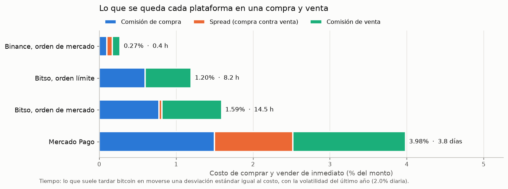
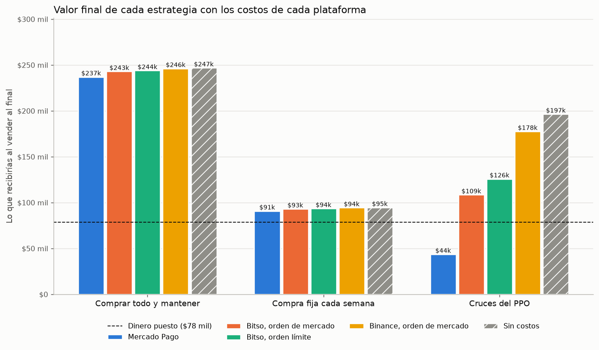
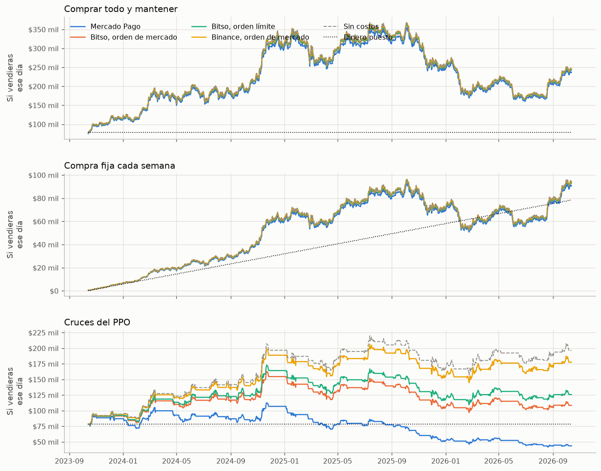
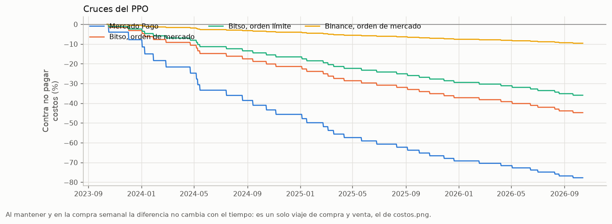
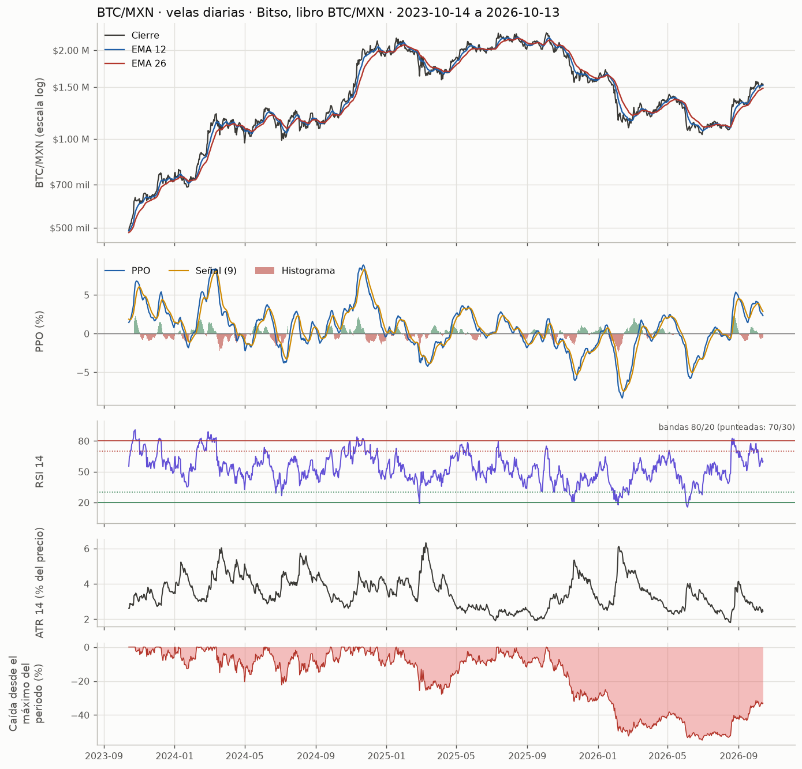

# Bitcoin con pesos: costos por plataforma y tres estrategias

Datos: Bitso, libro BTC/MXN, velas diarias, del 2023-10-14 al 2026-10-13 (1,096 velas). Volatilidad del último año: 2.0% diaria. Generado el 2026-10-14 23:36 (hora de la Ciudad de México) con `btc_macd.py`.

Ejercicio académico: describe costos y lo que habría pasado en el pasado. No es una recomendación de inversión.

## Costos por plataforma

| Plataforma                | Comisión compra   | Comisión venta   | Spread   | Origen del spread                          | Compra y venta   | Tiempo para recuperarlo   | Fuente                                                                                                                                        |
|:--------------------------|:------------------|:-----------------|:---------|:-------------------------------------------|:-----------------|:--------------------------|:----------------------------------------------------------------------------------------------------------------------------------------------|
| Binance, orden de mercado | 0.10%             | 0.10%            | 0.073%   | libro guardado, 2026-10-14 21:25 UTC       | 0.27%            | 0.4 h                     | Comisión spot estándar de 0.1% (criptoinforme.com, 5 de octubre de 2026; finantres.mx, 14 de octubre de 2026). Spread: libro BTC/MXN por API. |
| Bitso, orden límite       | 0.60%             | 0.60%            | 0.000%   | fijo en el archivo, 0.00%                  | 1.20%            | 8.2 h                     | bitso.com/mx/fees, comisión maker con menos de 20,000 MXN al mes (consultada el 2026-10-14).                                                  |
| Bitso, orden de mercado   | 0.78%             | 0.78%            | 0.038%   | libro guardado, 2026-10-14 21:25 UTC       | 1.59%            | 14.5 h                    | bitso.com/mx/fees, comisión taker con menos de 20,000 MXN al mes (consultada el 2026-10-14). Spread: libro BTC/MXN por API.                   |
| Mercado Pago              | 1.50%             | 1.50%            | 1.035%   | cotización en la app, 2026-10-15 04:59 UTC | 3.98%            | 3.8 días                  | Comisión: Luis, en la app de Mercado Pago (octubre de 2026). Spread: precios de compra y venta anotados de la app con cotiza --manual.        |

*Compra y venta* es lo que pierdes si compras y vendes de inmediato. *Tiempo para recuperarlo* es lo que suele tardar bitcoin en moverse una desviación estándar igual a ese costo: (costo / volatilidad diaria)².

## Tres estrategias con el mismo dinero

Compra fija: $500 cada 7 días, 157 compras, $78 mil en total. Las otras dos ponen esos $78 mil desde el primer día: una compra y mantiene; la otra compra en cada cruce del PPO al alza y vende en cada cruce a la baja, al cierre de la vela siguiente (retraso de 1). El valor es lo que recibirías si vendieras, ya con costos. *Peor momento* es la mayor pérdida contra el dinero puesto en algún punto del camino.

| Estrategia              | Plataforma                | Valor final   | Rendimiento   | Costos pagados   |   Operaciones |   BTC al final | Peor momento   |
|:------------------------|:--------------------------|:--------------|:--------------|:-----------------|--------------:|---------------:|:---------------|
| Comprar todo y mantener | Mercado Pago              | $237,159      | 202.1%        | $7,470           |             1 |       0.158807 | -4.0%          |
| Comprar todo y mantener | Bitso, orden de mercado   | $243,064      | 209.6%        | $2,585           |             1 |       0.159782 | -1.6%          |
| Comprar todo y mantener | Bitso, orden límite       | $244,040      | 210.9%        | $1,944           |             1 |       0.160102 | -1.2%          |
| Comprar todo y mantener | Binance, orden de mercado | $246,323      | 213.8%        | $443             |             1 |       0.160849 | -0.3%          |
| Comprar todo y mantener | Sin costos                | $246,995      | 214.6%        | $0               |             1 |       0.161069 | 0.0%           |
| Compra fija cada semana | Mercado Pago              | $90,954       | 15.9%         | $3,545           |           157 |       0.060905 | -22.0%         |
| Compra fija cada semana | Bitso, orden de mercado   | $93,219       | 18.8%         | $1,378           |           157 |       0.061279 | -20.0%         |
| Compra fija cada semana | Bitso, orden límite       | $93,593       | 19.2%         | $1,036           |           157 |       0.061402 | -19.7%         |
| Compra fija cada semana | Binance, orden de mercado | $94,469       | 20.3%         | $236             |           157 |       0.061688 | -18.9%         |
| Compra fija cada semana | Sin costos                | $94,727       | 20.7%         | $0               |           157 |       0.061772 | -18.7%         |
| Cruces del PPO          | Mercado Pago              | $43,707       | -44.3%        | $114,647         |            74 |       0        | -46.7%         |
| Cruces del PPO          | Bitso, orden de mercado   | $108,579      | 38.3%         | $69,630          |            74 |       0        | -1.6%          |
| Cruces del PPO          | Bitso, orden límite       | $125,939      | 60.4%         | $56,397          |            74 |       0        | -1.2%          |
| Cruces del PPO          | Binance, orden de mercado | $177,723      | 126.4%        | $15,367          |            74 |       0        | -0.3%          |
| Cruces del PPO          | Sin costos                | $196,594      | 150.4%        | $0               |            74 |       0        | 0.0%           |

Al mantener y en la compra semanal, cada peso paga la compra una vez y la venta una vez, así que la diferencia contra no pagar costos es la misma de una compra y venta inmediata. En los cruces se paga en cada operación y se acumula.

## Lo que dicen los números

- Comprar y vender de inmediato cuesta desde 0.27% en Binance, orden de mercado hasta 3.98% en Mercado Pago.
- Comprando $500 cada semana, con Binance, orden de mercado habrías juntado 0.061688 BTC, 1.3% más que con Mercado Pago (0.060905 BTC).
- Los cruces del PPO pidieron 74 operaciones. Con los costos de Mercado Pago el valor final queda 77.8% abajo del que tendrías sin pagar costos.
- Con Mercado Pago, la estrategia que terminó con más dinero fue «Comprar todo y mantener» ($237 mil).
- El PPO de bitcoin cruzó su señal una vez cada 14.8 días. Una caminata aleatoria cruza cada 12 periodos, así que cruza menos seguido que el azar.

## Indicadores

PPO (MACD en % de la EMA lenta), RSI de 14 con bandas 80/20, ATR de 14 en % del precio y caída desde el máximo. Un RSI arriba de 70 es normal en las tendencias fuertes de bitcoin, por eso las bandas van en 80/20.

## Avisos

- Binance P2P queda fuera: su spread no está medido (python btc_macd.py cotiza --manual "Binance P2P" COMPRA VENTA).
